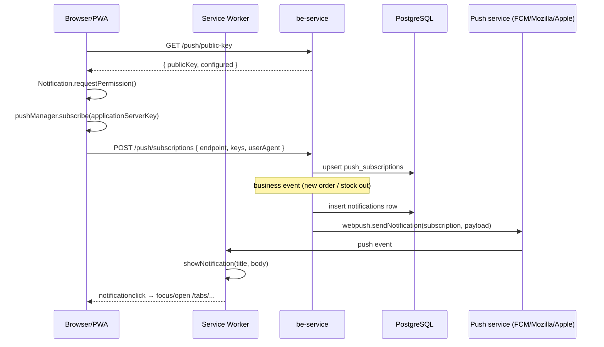

# PWA Web Push Notifications

## Purpose

Deliver order and stock alerts to the device even when the PWA is closed, without
introducing a native push pipeline. The in-app inbox stays the source of truth:
every push mirrors a row in the `notifications` table.

Scope: **web/PWA only**. Capacitor WebViews (iOS and Android) do not implement
`PushManager`; the Settings toggle renders as "Không hỗ trợ" there and native
push remains a separate future phase.

## Data model

`push_subscriptions` (migration `0032_lame_firelord.sql`):

| Column | Type | Notes |
|---|---|---|
| `id` | uuid pk | |
| `user_id` | uuid → `users.id` | `ON DELETE CASCADE` |
| `endpoint` | text unique | browser-managed push endpoint; upsert key |
| `p256dh` | text | client public key from `PushSubscription.keys` |
| `auth` | text | client auth secret |
| `user_agent` | text | diagnostics only |
| `created_at` / `updated_at` | timestamp | |
| `last_used_at` | timestamp | set after a successful send |

One user may own several rows (phone + desktop). The same endpoint is never
duplicated: re-subscribing updates keys and owner.

## Flow



Payload contract (`PushService`):

```json
{ "title": "Đơn hàng mới #DH001", "body": "Đơn hàng giá trị 500.000đ vừa được tạo", "url": "/tabs/orders/detail/<id>", "tag": "order" }
```

`url` is derived from `notification.meta.referenceType` by
`notification-link.util.ts`, so the service worker can deep-link without knowing
business routes.

## API surface

All routes require the JWT bearer token.

| Method | Path | Body | Response |
|---|---|---|---|
| GET | `/api/v1/push/public-key` | — | `{ publicKey: string \| null, configured: boolean }` |
| POST | `/api/v1/push/subscriptions` | `{ endpoint, keys: { p256dh, auth }, userAgent? }` | `201 { devices }` |
| DELETE | `/api/v1/push/subscriptions` | `{ endpoint }` | `{ removed, devices }` |
| POST | `/api/v1/push/test` | — | `200 { devices }`, `400` when no device, `503` when VAPID missing |

## Configuration

`be-service/.env`:

```bash
VAPID_PUBLIC_KEY=...
VAPID_PRIVATE_KEY=...
VAPID_SUBJECT=mailto:admin@aiom.local
```

Generate keys once with `npx web-push generate-vapid-keys`. Rotating the pair
invalidates every existing subscription; clients re-subscribe on next toggle.

When the keys are absent the server logs `push_vapid_missing` and skips delivery:
in-app notifications keep working, `POST /push/test` returns `503`.

## Edge cases

- **Dead subscription** (HTTP 404/410): the row is deleted during the send, so
  repeated failures do not accumulate.
- **Other send failures** (network, 5xx): logged as `push_send_failed`; the
  subscription is kept and the in-app row already exists.
- **Server data loss / account switch**: `syncPushSubscription()` runs once on
  app start and re-posts an existing browser subscription to the backend.
- **Permission denied**: `Notification.permission === "denied"` short-circuits
  the toggle; the UI tells the user to allow notifications in site settings.
- **Delivery is best-effort**: `NotificationService.notifyUsers` fires push after
  the DB insert and never lets a push error fail the business transaction.

## Verification

1. `cd be-service && deno task format && deno check src/app.ts`
2. `cd mobile-app && npm run lint && npx tsc --noEmit && npm run build`
3. Confirm `dist/sw.js` contains `importScripts("push-sw.js")` and
   `dist/push-sw.js` contains `showNotification`.
4. Serve the build over HTTPS (or `localhost`) with VAPID keys configured, open
   Settings → enable "Nhận thông báo đẩy", press "Gửi thông báo thử".
5. Create an order as another user: the recipient sees the OS notification; the
   click opens the order detail route.
